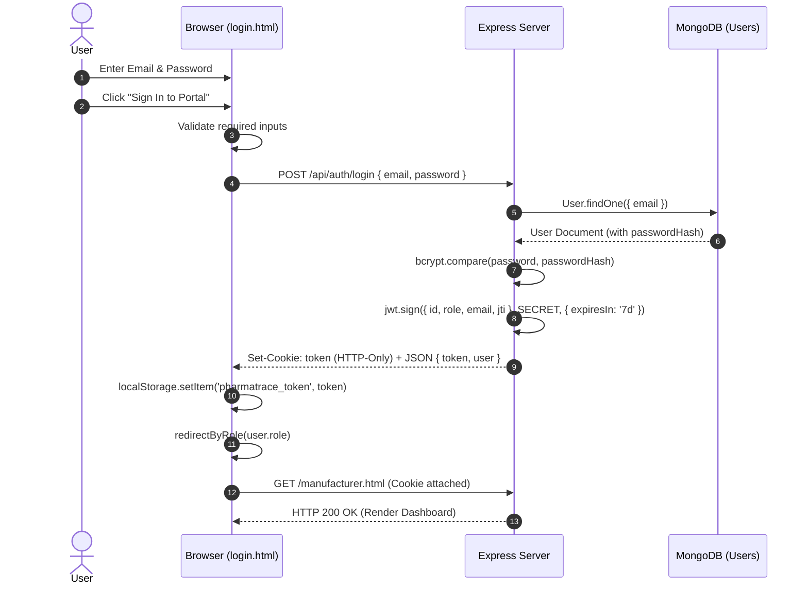

# PharmaTrace – Web Technology Practical Examination Guide

**Project Name:** PharmaTrace – Pharmaceutical Supply Chain Traceability & Medicine Authentication Platform  
**Architecture:** Client-Server / RESTful Architecture (Frontend: HTML5, CSS3, JavaScript ES6+ • Backend: Node.js, Express.js, MongoDB with Mongoose, JWT)

---

## Table of Contents
1. [HTML5 Structure & Semantic Layout](#1-html5-structure--semantic-layout)
2. [CSS3 Styling & Responsive Design](#2-css3-styling--responsive-design)
3. [JavaScript (ES6+) Architecture & State Management](#3-javascript-es6-architecture--state-management)
4. [Client-Side Form Validation](#4-client-side-form-validation)
5. [Login Authentication Flow & Session Security](#5-login-authentication-flow--session-security)
6. [Role-Based Access Control (RBAC) & Navigation](#6-role-based-access-control-rbac--navigation)
7. [Backend API Integration & Endpoints](#7-backend-api-integration--endpoints)
8. [Comprehensive Code Breakdown of All 8 Key UI Elements](#8-comprehensive-code-breakdown-of-all-8-key-ui-elements)

---

## 1. HTML5 Structure & Semantic Layout

The PharmaTrace authentication gateway is structured using modern HTML5 semantic elements:

* `<nav class="navbar">`: Container populated dynamically by JavaScript (`renderNavbar('login')`). Displays the branding logo and the Staff Sign In action button.
* `<main class="auth-container">`: Primary landmark housing the central authentication card (`.auth-card`).
* `<form id="loginForm">`: Dedicated semantic form container equipped with `autocomplete` and `required` attributes.
* `<div class="auth-tabs">`: Segmented control navigation buttons allowing users to switch between Sign In, Manufacturer Registration, Retailer Registration, and Customer Registration without reloading the page.
* `<footer>`: Semantic footer containing compliance copyright notices.

### Actual HTML Code Structure (`login.html`):
```html
<!DOCTYPE html>
<html lang="en">
<head>
    <meta charset="UTF-8">
    <meta name="viewport" content="width=device-width, initial-scale=1.0">
    <title>PharmaTrace – Enterprise Authentication & Role Gateway</title>
    <link rel="stylesheet" href="style.css">
</head>
<body>
    <nav class="navbar"></nav>

    <main class="auth-container">
        <div class="auth-card">
            <!-- Branding Header -->
            <div class="auth-header">
                <div class="auth-logo-badge">💊</div>
                <h1>PharmaTrace</h1>
                <p>Enterprise Pharmaceutical Traceability & Authentication</p>
            </div>

            <!-- Role Tabs -->
            <div class="auth-tabs">
                <button type="button" class="auth-tab-btn active" onclick="switchAuthTab('login')">Sign In</button>
                <button type="button" class="auth-tab-btn" onclick="switchAuthTab('reg-manufacturer')">Manufacturer</button>
                <button type="button" class="auth-tab-btn" onclick="switchAuthTab('reg-retailer')">Retailer</button>
                <button type="button" class="auth-tab-btn" onclick="switchAuthTab('reg-customer')">Customer</button>
            </div>

            <div id="authAlert" class="alert"></div>

            <!-- Login Form -->
            <form id="loginForm">
                <div class="form-group">
                    <label for="loginEmail">Email / Username *</label>
                    <input id="loginEmail" type="email" placeholder="name@company.com" autocomplete="username" required>
                </div>

                <div class="form-group">
                    <div style="display: flex; justify-content: space-between; align-items: center; margin-bottom: 6px;">
                        <label for="loginPassword" style="margin-bottom: 0;">Password *</label>
                        <a href="#" onclick="switchAuthTab('forgot'); return false;">Forgot Password?</a>
                    </div>
                    <div class="password-wrapper">
                        <input id="loginPassword" type="password" placeholder="••••••••" autocomplete="current-password" required>
                        <button type="button" class="password-toggle-btn" onclick="togglePasswordVisibility('loginPassword', this)">👁️</button>
                    </div>
                </div>

                <button id="loginSubmitBtn" type="submit" class="btn btn-block">Sign In to Portal</button>
            </form>
        </div>
    </main>
</body>
</html>
```

---

## 2. CSS3 Styling & Responsive Design

PharmaTrace implements a corporate healthcare design system using CSS Flexbox, Grid, and CSS Variables:
- **Primary Navy / Slate Palette:** Background `#f8fafc`, text `#0f172a`, card borders `#e2e8f0`.
- **Medical Blue Accent:** Primary action `#0284c7`, hover `#0369a1`.
- **Status Indicators:** Success green `#10b981`, alert amber `#f59e0b`, danger red `#ef4444`.

### Key CSS Classes (`style.css`):

#### 1. Container & Card Elevation
```css
.auth-container {
    max-width: 520px;
    margin: 40px auto 60px auto;
    padding: 0 16px;
}

.auth-card {
    background: #ffffff;
    border-radius: 14px;
    box-shadow: 0 10px 25px -5px rgba(15, 23, 42, 0.08), 0 8px 10px -6px rgba(15, 23, 42, 0.04);
    border: 1px solid #e2e8f0;
    padding: 32px 28px;
}
```

#### 2. Segmented Role Tabs
```css
.auth-tabs {
    display: flex;
    background: #f1f5f9;
    padding: 4px;
    border-radius: 10px;
    margin-bottom: 22px;
    gap: 4px;
}

.auth-tab-btn {
    flex: 1;
    padding: 8px 10px;
    border: none;
    background: transparent;
    font-size: 0.82rem;
    font-weight: 600;
    color: #64748b;
    border-radius: 6px;
    cursor: pointer;
    transition: all 0.15s ease;
    text-align: center;
}

.auth-tab-btn.active {
    background: #ffffff;
    color: #0f172a;
    box-shadow: 0 1px 3px rgba(0, 0, 0, 0.1);
}
```

#### 3. Primary Button System
```css
.btn {
    display: inline-flex;
    align-items: center;
    justify-content: center;
    gap: 8px;
    background-color: #0284c7;
    color: #ffffff;
    border: none;
    padding: 10px 20px;
    border-radius: 8px;
    font-size: 0.92rem;
    font-weight: 600;
    cursor: pointer;
    text-decoration: none;
    transition: background-color 0.2s, transform 0.1s;
}

.btn:hover {
    background-color: #0369a1;
}

.btn-block {
    width: 100%;
}
```

#### 4. Password Input Wrapper & Toggle
```css
.password-wrapper {
    position: relative;
    display: flex;
    align-items: center;
    width: 100%;
}

.password-toggle-btn {
    position: absolute;
    right: 10px;
    background: none;
    border: none;
    font-size: 1.05rem;
    cursor: pointer;
    color: #64748b;
    padding: 4px;
    border-radius: 4px;
}
```

---

## 3. JavaScript (ES6+) Architecture & State Management

The frontend uses asynchronous modern JavaScript (`async/await`, Fetch API, DOM manipulation).

### Reusable API Fetch Helper (`script.js`):
All network requests go through a unified `api()` function that attaches JWT bearer credentials and handles errors:
```javascript
async function api(path, options = {}) {
    const headers = {
        'Content-Type': 'application/json',
        ...(options.headers || {})
    };

    const token = localStorage.getItem('pharmatrace_token');
    if (token && !headers['Authorization']) {
        headers['Authorization'] = `Bearer ${token}`;
    }

    const response = await fetch(path, {
        headers,
        credentials: 'include', // Sends HTTP-only cookie automatically
        ...options
    });

    const data = await response.json().catch(() => ({}));

    if (!response.ok) {
        throw new Error(data.message || 'Request failed. Please try again.');
    }

    return data;
}
```

---

## 4. Client-Side Form Validation

Form validation occurs in two layers:
1. **HTML5 Native Constraints**:
   - `required`: Prevents submission if fields are blank.
   - `type="email"`: Enforces RFC 5322 email syntax (`user@domain.com`).
   - `minlength="6"`: Enforces minimum password strength.
2. **JavaScript Event Interception**:
   - `e.preventDefault()` halts browser page reloading.
   - Values are trimmed (`.trim()`) to prevent whitespace bypass.
   - Submit buttons are disabled during network requests with loading indicators (`Verifying credentials...`) to prevent duplicate submissions.

---

## 5. Login Authentication Flow & Session Security



### Security Measures Implemented:
1. **Password Hashing**: Passwords are never stored in plaintext; they are hashed with `bcrypt.hash(password, 10)` with automatic salt generation.
2. **Dual-Layer JWT Delivery**: The JWT token is returned in the JSON response (stored in `localStorage` for API headers) AND set in an **HTTP-only cookie** (`res.cookie('token', token, { httpOnly: true, sameSite: 'lax' })`) to prevent Cross-Site Scripting (XSS) extraction.
3. **Server-Side Token Revocation**: Each JWT contains a unique `jti` UUID. Calling `POST /api/auth/logout` places the token on a server-side revocation list, preventing token reuse.

---

## 6. Role-Based Access Control (RBAC) & Navigation

PharmaTrace supports four role types with isolated dashboards:

| Role | Permitted Pages | Prohibited Pages | Allowed Operations |
| :--- | :--- | :--- | :--- |
| **Manufacturer** | `manufacturer.html` | `retailer.html`, `admin.html` | Register batches, generate QR labels, view own catalog |
| **Retailer** | `retailer.html` | `manufacturer.html`, `admin.html` | Receive stock, update status (In Stock/Sold), scan QR |
| **Customer** | `customer.html` | `manufacturer.html`, `retailer.html`, `admin.html` | Public QR authenticity check, view expiry & recalls |
| **Admin** | `admin.html`, all portals | None | User management, audit logs, system-wide recalls |

### Role Redirection Function (`login.html`):
```javascript
function redirectByRole(role) {
    const params = new URLSearchParams(window.location.search);
    const redirect = params.get('redirect');
    if (redirect && !redirect.includes('login.html')) {
        window.location.href = redirect;
        return;
    }
    if (role === 'admin') window.location.href = 'admin.html';
    else if (role === 'manufacturer') window.location.href = 'manufacturer.html';
    else if (role === 'retailer') window.location.href = 'retailer.html';
    else window.location.href = 'customer.html';
}
```

---

## 7. Backend API Integration & Endpoints

| Endpoint | HTTP Method | Auth Required | Purpose |
| :--- | :--- | :--- | :--- |
| `/api/auth/login` | `POST` | Public | Authenticates credentials, returns JWT token and user info |
| `/api/auth/register` | `POST` | Public | Creates new Manufacturer, Retailer, or Customer account |
| `/api/auth/logout` | `POST` | Optional / Bearer | Invalidates token server-side and clears session cookie |
| `/api/auth/me` | `GET` | Bearer / Cookie | Returns current authenticated user profile |
| `/api/auth/forgot-password`| `POST` | Public | Generates password reset token |
| `/api/auth/reset-password` | `POST` | Public | Validates reset token and sets new hashed password |

---

## 8. Comprehensive Code Breakdown of All 8 Key UI Elements

### 1. Sign In Button (`#loginSubmitBtn`)
* **HTML Code:**
  ```html
  <button id="loginSubmitBtn" type="submit" class="btn btn-block" style="padding: 12px; font-size: 0.95rem; margin-top: 8px;">
      Sign In to Portal
  </button>
  ```
* **CSS Classes:** `.btn`, `.btn-block` in `style.css`.
* **JavaScript Event Listener (`login.html`):**
  ```javascript
  document.getElementById('loginForm').addEventListener('submit', async (e) => {
      e.preventDefault();
      alertBox.style.display = 'none';
      const btn = document.getElementById('loginSubmitBtn');
      const origText = btn.textContent;
      btn.disabled = true;
      btn.textContent = 'Verifying credentials...';

      try {
          const res = await api('/api/auth/login', {
              method: 'POST',
              body: JSON.stringify({
                  email: document.getElementById('loginEmail').value.trim(),
                  password: document.getElementById('loginPassword').value
              })
          });
          if (res.token) localStorage.setItem('pharmatrace_token', res.token);
          if (res.user) localStorage.setItem('pharmatrace_user', JSON.stringify(res.user));
          showMessage(alertBox, `Authenticated as ${res.user.role.toUpperCase()} (${res.user.name})! Redirecting to your dashboard...`, 'success');
          setTimeout(() => redirectByRole(res.user.role), 600);
      } catch (err) {
          btn.disabled = false;
          btn.textContent = origText;
          showMessage(alertBox, err.message, 'error');
      }
  });
  ```
* **Backend API:** `POST /api/auth/login`
* **How It Works:** Intercepts form submission, displays a loading state on the button, issues a `POST` request to `/api/auth/login`, saves the returned token into `localStorage`, and triggers `redirectByRole()` to navigate to the user's portal.

---

### 2. Manufacturer Selection Tab
* **HTML Code:**
  ```html
  <button type="button" class="auth-tab-btn" onclick="switchAuthTab('reg-manufacturer')">Manufacturer</button>
  ```
* **CSS Classes:** `.auth-tab-btn`, `.auth-tab-btn.active`, `.auth-tabs`.
* **JavaScript Function (`login.html`):**
  ```javascript
  function switchAuthTab(tab) {
      alertBox.style.display = 'none';
      document.querySelectorAll('.auth-tab-btn').forEach(b => b.classList.remove('active'));

      const forms = ['loginForm', 'mfgRegForm', 'retRegForm', 'custRegForm', 'forgotPasswordView'];
      forms.forEach(f => {
          const el = document.getElementById(f);
          if (el) el.style.display = 'none';
      });

      const tabs = document.querySelectorAll('.auth-tab-btn');
      if (tab === 'reg-manufacturer') {
          document.getElementById('mfgRegForm').style.display = 'block';
          if (tabs[1]) tabs[1].classList.add('active');
      }
  }
  ```
* **Backend API:** None on tab click. When the revealed form `#mfgRegForm` is submitted, it calls `POST /api/auth/register`.
* **How It Works:** Toggles DOM element visibility (`display: none` / `display: block`), hiding all other forms and rendering the Manufacturer registration form while applying active tab styling.

---

### 3. Retailer Selection Tab
* **HTML Code:**
  ```html
  <button type="button" class="auth-tab-btn" onclick="switchAuthTab('reg-retailer')">Retailer</button>
  ```
* **CSS Classes:** `.auth-tab-btn`, `.auth-tab-btn.active`.
* **JavaScript Function (`login.html`):**
  ```javascript
  else if (tab === 'reg-retailer') {
      document.getElementById('retRegForm').style.display = 'block';
      if (tabs[2]) tabs[2].classList.add('active');
  }
  ```
* **Backend API:** None on click. Submitting `#retRegForm` calls `POST /api/auth/register`.
* **How It Works:** Dynamically reveals the retail pharmacy registration fields (store name, license number, pharmacy location) without reloading the page.

---

### 4. Customer Selection Tab
* **HTML Code:**
  ```html
  <button type="button" class="auth-tab-btn" onclick="switchAuthTab('reg-customer')">Customer</button>
  ```
* **CSS Classes:** `.auth-tab-btn`, `.auth-tab-btn.active`.
* **JavaScript Function (`login.html`):**
  ```javascript
  else if (tab === 'reg-customer') {
      document.getElementById('custRegForm').style.display = 'block';
      if (tabs[3]) tabs[3].classList.add('active');
  }
  ```
* **Backend API:** None on click. Submitting `#custRegForm` calls `POST /api/auth/register`.
* **How It Works:** Switches the interface to consumer registration fields (Full Name, Email, Mobile Number, Password).

---

### 5. Password Show/Hide Button
* **HTML Code:**
  ```html
  <button type="button" class="password-toggle-btn" onclick="togglePasswordVisibility('loginPassword', this)" title="Show/Hide Password">
      👁️
  </button>
  ```
* **CSS Classes:** `.password-wrapper`, `.password-toggle-btn`.
* **JavaScript Function (`login.html`):**
  ```javascript
  function togglePasswordVisibility(inputId, btn) {
      const input = document.getElementById(inputId);
      if (!input) return;
      if (input.type === 'password') {
          input.type = 'text';
          btn.textContent = '🙈';
      } else {
          input.type = 'password';
          btn.textContent = '👁️';
      }
  }
  ```
* **Backend API:** None (purely client-side DOM manipulation).
* **How It Works:** Toggles the HTML `<input>` element's `type` attribute between `"password"` (dots/masked) and `"text"` (visible plain text) while updating the button's emoji icon.

---

### 6. Forgot Password Button
* **HTML Code:**
  ```html
  <a href="#" onclick="switchAuthTab('forgot'); return false;" style="font-size: 0.8rem; color: #0284c7; text-decoration: none; font-weight: 600;">
      Forgot Password?
  </a>
  ```
* **CSS Classes:** Inline styles (`color: #0284c7; font-weight: 600; text-decoration: none;`).
* **JavaScript Function (`login.html`):**
  ```javascript
  else if (tab === 'forgot') {
      document.getElementById('forgotPasswordView').style.display = 'block';
  }
  ```
* **Backend API:**
  - Step 1: `POST /api/auth/forgot-password` (issues token).
  - Step 2: `POST /api/auth/reset-password` (saves new password).
* **How It Works:** Shows `#forgotPasswordView`, where the user requests a reset token via email and enters a new password.

---

### 7. Instant Demo Account Buttons
* **HTML Code:**
  ```html
  <div class="demo-pill-grid">
      <button type="button" class="demo-pill-btn" onclick="fillCredentials('admin@pharmatrace.com', 'Admin@12345')">
          <span class="demo-role-title">👑 Admin</span>
          <span class="demo-role-sub">Full system control</span>
      </button>
      <button type="button" class="demo-pill-btn" onclick="fillCredentials('manufacturer@apexpharma.com', 'Password@123')">
          <span class="demo-role-title">🏭 Mfg A (Apex)</span>
          <span class="demo-role-sub">Own batches only</span>
      </button>
      <button type="button" class="demo-pill-btn" onclick="fillCredentials('biocare@manufacturer.com', 'Password@123')">
          <span class="demo-role-title">🧪 Mfg B (BioCare)</span>
          <span class="demo-role-sub">Isolated catalog</span>
      </button>
      <button type="button" class="demo-pill-btn" onclick="fillCredentials('retailer@apollocare.com', 'Password@123')">
          <span class="demo-role-title">🏪 Retailer</span>
          <span class="demo-role-sub">Stock & dispense</span>
      </button>
      <button type="button" class="demo-pill-btn" onclick="fillCredentials('customer@example.com', 'Password@123')">
          <span class="demo-role-title">📱 Customer</span>
          <span class="demo-role-sub">Medicine verification</span>
      </button>
  </div>
  ```
* **CSS Classes:** `.demo-box`, `.demo-pill-grid`, `.demo-pill-btn`, `.demo-role-title`, `.demo-role-sub`.
* **JavaScript Function (`login.html`):**
  ```javascript
  function fillCredentials(email, password) {
      switchAuthTab('login');
      document.getElementById('loginEmail').value = email;
      document.getElementById('loginPassword').value = password;
      showMessage(alertBox, `Filled credentials for ${email}. Click "Sign In to Portal" to log in.`, 'info');
  }
  ```
* **Backend API:** None on click. Populates input fields for `POST /api/auth/login`.
* **How It Works:** Automatically switches to the Sign In tab, populates the email and password `<input>` values, and displays a guidance alert for instant role testing during practical viva examination demonstrations.

---

### 8. Staff Sign In Button (Top Navbar)
* **HTML Code (Generated Dynamically via `script.js`):**
  ```html
  <a href="login.html" class="btn btn-sm btn-secondary">🔐 Staff Sign In →</a>
  ```
* **CSS Classes:** `.btn`, `.btn-sm`, `.btn-secondary` in `style.css`.
* **JavaScript Function (`script.js`):**
  ```javascript
  async function renderNavbar(activePage = '') {
      const nav = document.querySelector('.navbar');
      if (!nav) return;

      const user = await fetchCurrentUser();

      let brandHtml = '';
      let navLinksHtml = '';

      if (activePage === 'login') {
          // Clean login navbar: Brand only, no extraneous links
          brandHtml = `<a class="nav-brand" href="login.html"><span>💊 PharmaTrace</span></a>`;
          navLinksHtml = '';
      }
      ...
      let authSection = '';
      if (!user) {
          authSection = `<a href="login.html" class="btn btn-sm btn-secondary">🔐 Staff Sign In →</a>`;
      }

      nav.innerHTML = `
          <div class="nav-container">
              ${brandHtml}
              <ul class="nav-links">${navLinksHtml}</ul>
              <div class="nav-auth">${authSection}</div>
          </div>
      `;
  }
  ```
* **Backend API:** `GET /api/auth/me` (called by `fetchCurrentUser()` to determine login status).
* **How It Works:** Renders on every public page (and clean login navbar) when the user is not authenticated, providing a direct link to the central login gateway.
